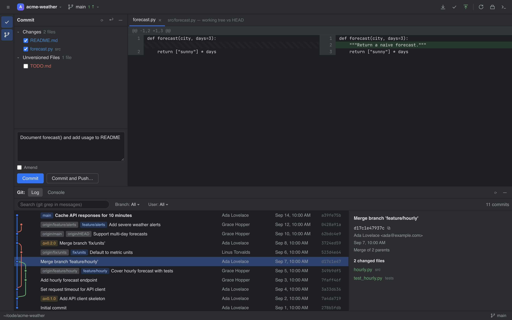
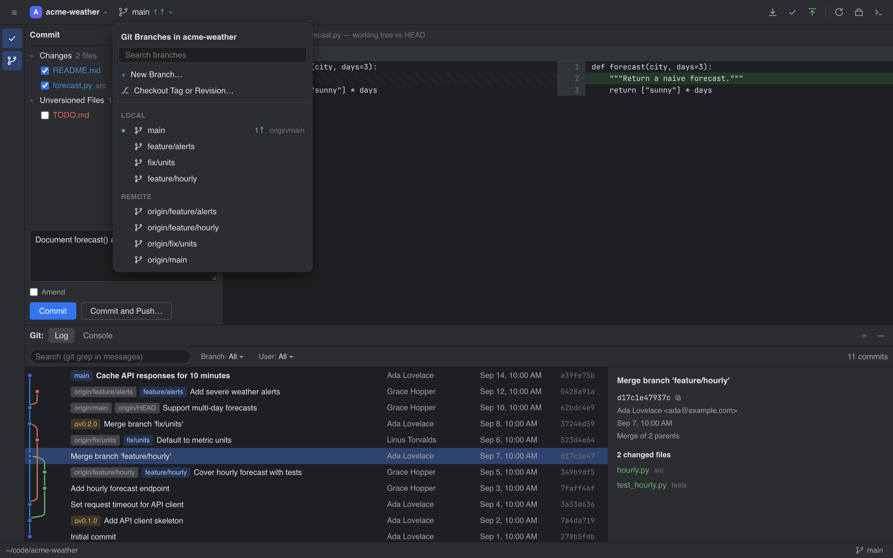
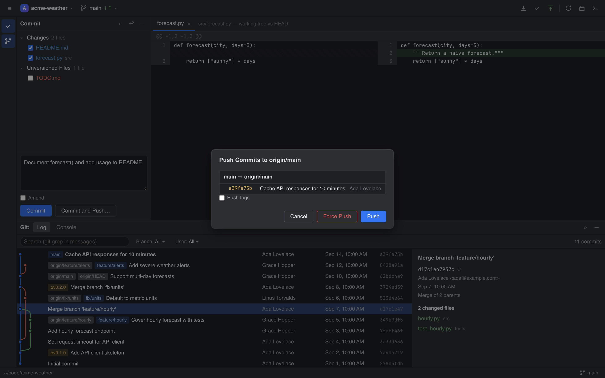

<h1 align="center">GitLoved</h1>

<p align="center">
  <b>The JetBrains IDE Git experience — as a standalone app for any repository.</b><br>
  Branch widget, Commit tool window, Log with commit graph, push/pull dialogs, conflict resolution, Git console.
</p>

<p align="center">
  
  
  
  
</p>

<p align="center">
  
</p>

If you've ever left IntelliJ, PyCharm or WebStorm for another editor and missed the way they do Git, GitLoved is for you. It recreates the JetBrains Git plugin (New UI, Dark theme) in your browser. Point it at any local repository and get the same branch popup, the same Commit window, and the same Log with its colored commit graph. It works no matter which editor you write code in.

- **Zero dependencies.** One Python file plus three static files. Standard library only: no `pip install`, no `npm`, no build step.
- **Real git, nothing simulated.** Every button runs your actual `git` binary. The **Console** tab shows each command that ran and its output.
- **Local only.** The server binds to `127.0.0.1` and refuses requests from other websites (see [Security](#security)).

## Quick start

```bash
git clone https://github.com/anirtek/GitLoved.git
cd GitLoved
python3 gitloved.py                  # opens the Welcome screen in your browser
python3 gitloved.py ~/code/my-repo   # or jump straight into a repository
```

That's it. Requirements: **Python 3.8+** and **git** on your `PATH`.

```
usage: gitloved [-h] [--port PORT] [--no-browser] [--version] [repo]

  repo          repository to open (default: Welcome screen)
  --port PORT   port to listen on (default: 8765)
  --no-browser  don't open a browser tab
```

> **Tip:** add an alias such as `alias gl='python3 ~/GitLoved/gitloved.py "$PWD"'`, then run `gl` inside any repo.

## Screenshots

<table>
  <tr>
    <td width="50%"></td>
    <td width="50%"></td>
  </tr>
  <tr>
    <td align="center"><b>Branch widget</b>: search, checkout, merge, rebase, rename, delete</td>
    <td align="center"><b>Push dialog</b>: preview outgoing commits, force-with-lease</td>
  </tr>
</table>

## Features

| JetBrains Git plugin | GitLoved |
|---|---|
| **Branch widget** in the main toolbar | Click the branch name. Search, **New Branch…**, **Checkout Tag or Revision…**, Local / Remote sections, per-branch actions (Checkout, Merge into Current, Rebase Current onto, Rename, Delete, Delete on Remote), incoming/outgoing `↓ ↑` counters, stash list |
| **Commit tool window** (`⌘0`) | Changes / Unversioned Files / Merge Conflicts groups with checkboxes, commit message, **Amend**, **Commit**, **Commit and Push…**, per-file Rollback and Show Diff, right-click context menus |
| **Git tool window → Log** (`⌘9`) | Commit graph with colored lanes, ref chips (local / remote / tag / HEAD), author / date / hash columns, text + branch + user filters, details pane with changed files |
| **Log context menu** | Copy Revision Number, Checkout Revision, New Branch from Here…, New Tag…, Cherry-Pick, Revert Commit (merge commits use `-m 1`), Reset Current Branch to Here… (soft / mixed / hard / keep) |
| **Update Project / Push** dialogs | Pull with Merge or Rebase, `--ff-only`, `--prune`. Push previews outgoing commits, sets the upstream for new branches, and Force Push uses `--force-with-lease` |
| **Conflict resolution** | Banner in the Commit panel plus a dialog with **Accept Yours / Accept Theirs**, and Abort / Continue for merge, rebase, cherry-pick and revert |
| **Diff viewer** | Side by side, using JetBrains diff colors (green added / blue changed / muted deleted) with word-level highlighting |
| **Git console** | Every command it ran, with timestamps and output; errors in red |
| **Notifications** | Balloons in the bottom-right corner ("Pushed 2 commits to origin/main") |
| **Welcome screen** | Recent projects, an **Open…** directory browser (offers `git init` for folders that aren't repos), and a **Get from VCS…** clone dialog |

### Keyboard shortcuts

| Shortcut | Action |
|---|---|
| `⌘K` / `Ctrl+K` | Commit (opens the Commit panel and focuses the message) |
| `⇧⌘K` / `Shift+Ctrl+K` | Push |
| `⌘0` / `Ctrl+0` | Toggle Commit panel |
| `⌘9` / `Ctrl+9` | Toggle Git panel |
| `⌘D` / `Ctrl+D` | Diff of selected file |
| `Esc` | Close popup / dialog |

## How it works

```
GitLoved/
├── gitloved.py        # stdlib HTTP server + JSON API over `git` (subprocess)
└── static/
    ├── index.html     # IntelliJ New UI window layout
    ├── style.css      # New UI Dark design tokens
    └── app.js         # branch widget, dialogs, commit graph, diff viewer
```

- `gitloved.py` is a small `http.server` app. It serves the UI and a JSON API (`/api/status`, `/api/log`, `/api/action`, …), and each endpoint runs `git` as a subprocess with an argument list, never through a shell.
- The commit graph is drawn in the browser. `app.js` assigns lanes over `git log --topo-order --parents`.
- The UI polls for changes, so commits you make from a terminal or another editor show up automatically.
- Recent projects are stored in `~/.gitloved.json`. Nothing else is written outside your repositories.

## Security

GitLoved can run any git operation on the repository you open, so it only answers its own UI:

- It listens on `127.0.0.1` only and is never exposed to your network.
- It rejects requests whose `Host` header isn't `127.0.0.1:<port>` / `localhost:<port>`, which blocks DNS-rebinding attacks.
- It rejects cross-origin requests (`Origin` check), and every POST must be `application/json`. That stops other websites you visit from sending forged requests.

Push and pull run as you, using your normal git credentials. Remotes that need an interactive SSH or HTTPS prompt must have those credentials cached (SSH agent, credential helper) in the shell you start GitLoved from.

## Known limitations

- There's no in-editor 3-way merge tool. Resolve a conflicted file whole with Accept Yours / Theirs, or edit it in your editor, then click **Continue**.
- Not built yet: interactive rebase editor, partial/hunk staging, shelve, annotate/blame.
- The dark theme is the only theme.

## Roadmap

- [ ] 3-way merge editor
- [ ] Interactive rebase (reorder / squash / reword)
- [ ] Hunk and line staging
- [ ] Annotate (blame) view
- [ ] Shelve
- [ ] Light theme

Ideas and pull requests are welcome. Open an issue first if you're planning something big.

## Contributing

There's nothing to install or build. Edit the files and restart `python3 gitloved.py`; for frontend-only changes, refreshing the browser is enough.

1. Fork and create a branch.
2. Keep it dependency-free: Python standard library on the server, vanilla JS/CSS in the browser.
3. Every UI action should map to a real git command and show up in the Console.
4. Open a pull request with a screenshot if the UI changed.

## License

[MIT](LICENSE) © 2026 Aniruddha Tekade

*GitLoved is an independent project. It isn't affiliated with or endorsed by JetBrains. IntelliJ IDEA, PyCharm and WebStorm are trademarks of JetBrains s.r.o.*
